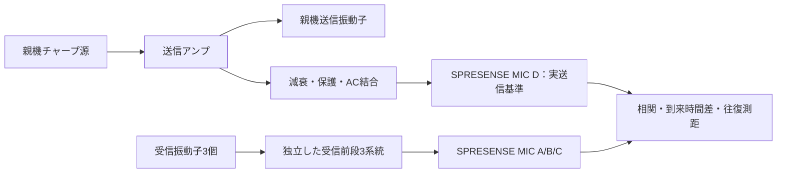
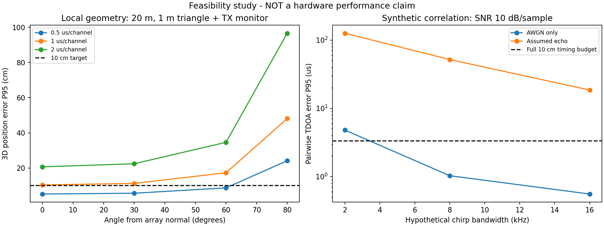

# SPRESENSE SBL：振動子の選定と設計成立条件

調査日：2026-09-14。ユーザー目標：SPRESENSE 1台でSBL、距離約20m、
最大ベースライン約1m、位置精度約10cm以下。低コスト・自作容易性・チャープ・複数子機対応を優先。

**結論：SMC20D17H5を少数評価の第一候補に選ぶ。20m・10cm用の最終採用品とはまだ言えない。**
公開情報で水中送受信の用途・小型・低価格を確認できた一方、駆動上限と防水後の複素特性が不足する。
このため本資料は選定調査と再現可能な机上検証の成果であり、完成基板・発注用資料ではない。

## 候補比較

価格は調査日に表示された米ドル価格。税、輸入費、国際送料、ケーブル、防水材、治具を含まない。
在庫表示は納期・日本への配送確約ではない。

| 候補 | 公式掲載の特徴 | 掲載価格 | 判断 |
|---|---|---:|---|
| [STEMINC SMC20D17H5](https://www.steminc.com/PZT/en/piezo-ceramic-cylinder-20x17x5mm-57-khz) | 裸円筒、57kHz±2kHz、内外面電極、水中送受信用途 | **32.84 / 2個** | **低価格評価の第一候補**。同型番の水中実験あり。帯域・防水・定格は要確認 |
| [STEMINC SMC25D22H12PLS](https://www.steminc.com/PZT/en/piezoelectric-cylinder-25x22x12mm-37-khz) | 裸円筒、37kHz±5kHz、水中通信用途 | 49.37 / 個 | 低周波代替。±5kHzは個体の共振公差であり、10kHz帯域ではない |
| [STEMINC SMC2622T13111SP](https://www.steminc.com/PZT/en/piezo-cylinder-stripe-electrode-43-khz) | 43kHz±2.5kHz、分割電極 | 59.40 / 個 | 初号機では電極構成を単純にしたい。価格面でも第一候補に劣る |
| [STEMINC SMC3831T25111](https://www.steminc.com/PZT/en/piezo-ceramic-cylinder-38x31x25mm-25-khz) | 25kHz±1kHz、38×31×25mm | 111.10 / 個 | 低周波化だけを理由に選ぶには高価・大型 |
| [Aquarian S1n](https://www.aquarianaudio.com/s1-hydrophone.html) | 防水完成品、受動型は送信にも使用可能、広帯域の公開資料あり | S1シリーズ379から（構成で変動） | 自作の容易さでは優位。全台採用は高価。借用・比較校正器候補 |

S1は調査時のページに6〜7週間のリードタイム記載あり。
S1nの送信データにはAS-1由来の値が含まれ、S1そのものの送信校正が揃っているとは解釈しない。
[S1公式データシート](../datasheets/Aquarian_S1_datasheet.pdf)

空中用40kHzセンサ、超音波洗浄用ボルト締め振動子は第一候補にしない。
空中防滴と水中送受信は異なり、洗浄用途の大電力定格だけでは音響通信の帯域・指向性が判断できない。
既存TD04Aは200kHz設計であり、今回のSPRESENSE音声入力を使う構成にはそのまま移植しない。

## 研究実績をどう扱うか

[Shaharearほか、ICASERT 2019](https://bpb-us-e1.wpmucdn.com/wp.txstate.edu/dist/f/1980/files/2022/09/Shaharear-2019-Low-cost-underwater-wireless-commun-1.pdf)
はSMC20D17H5の樹脂被覆と水中通信を報告するが、試験場所は8フィートの水槽である。
約47kHzを使用している一方、現在のメーカー裸素子仕様は57kHz。
ロット・実装・防水・測定条件の同一性は確認できず、「被覆すれば必ず47kHzになる」とは言えない。
同論文の回路、40Vの電源、50Ωという記述を、そのまま今回の定格や等価回路には転用しない。
この論文は20m到達やチャープ測位10cmの根拠ではない。

[UCSDの研究紹介](https://kastner.ucsd.edu/ryan/underwater-communications/)にも安価な圧電素子の水中通信実績がある。
ただし異なる素子・回路であり、歴史的な10ドルという価格や通信距離をSMC20D17H5へ転用しない。
[同研究グループの総括](https://kastner.ucsd.edu/research/underwater-systems-research/)
では安価なセラミックの個体差・時間変動も課題として挙げられている。

## 初号機の構成を具体化

SBL側SPRESENSEは1台＋公式拡張ボード。**受信振動子3個、送信振動子1個、音声入力4チャネル**を使う案とする。
4番目の入力は減衰・保護した実送信波形を収録する。API呼出し時刻を送信開始時刻とみなさず、
録音サンプルの座標で送信基準を取るためである。電気的監視から放射までの遅延は別途校正する。
4受信案も拡張として残すが、その場合は追加の送信時刻基準が必要となる。

チャープ源は、録音と両立が実機確認できればSPRESENSE音声出力を利用する。
**4ch・192kHz連続録音と送信の同時動作、アナログ入出力の実帯域は未検証**であり、
再生と録音が個別に対応しているだけで同時構成を保証しない。
成立しなければ安価な波形生成用補助回路へ切り替え、SPRESENSEは1台のままにする。

子機は送信1個・受信1個の別素子構成。マイコン型番と出力段はまだ決めない。
親機が個別IDを指定して呼び、指定子機だけが応答する。測距用プリアンブルは全子機で共通にして
波形差による時間バイアスを減らし、ID・連番・応答遅延・CRCをデータ部分へ載せる。
応答遅延は子機の検出関数が返った時刻ではなく、受信サンプル基準から実送信までの時間で定義する。
子機クロック誤差、送受信素子間の位置差も校正・誤差予算へ含める。
古い応答、衝突、CRC不一致、遅延期限超過を距離値として採用しない。
複数台とは時分割であり、同時送信を識別できる完成プロトコルではない。

親機4個＋子機2個で**合計6個＝3セット、素子代98.52米ドル**。
まず1セット32.84米ドルで送受信・帯域を評価し、合格してから残りを揃える。
これは素子だけの金額で、システム全体の費用見積りではない。購入・問い合わせ送信は行っていない。

## 1mアレイと測位条件

受信素子中心の座標案（m）：

| 受信点 | x | y | z |
|---|---:|---:|---:|
| A | 0 | 0.577350 | 0 |
| B | -0.5 | -0.288675 | 0 |
| C | +0.5 | -0.288675 | 0 |

各辺が1mの正三角形。送信点は重心付近を候補とし、振動子の音響中心・指向性・取り付けは実測して確定する。
円筒の径方向放射は球面全方向とは限らず、上下方向の感度低下を評価する。
平面アレイには表裏対称の曖昧さがあるため、初号機は対象をアレイの水中側半空間に限定する。
最初の受入試験領域は法線から30度以内を提案する。ユーザーが全方向10cmを承認したと扱わない。
斜め・浅い仰角では精度が低下する。20mは通信距離であり、耐水深20mを意味しない。

計算は [sbl_feasibility.py](../../sim/sbl_feasibility.py) で再現できる。
音速1500m/sの仮定で、20m先・1m基線で横方向10cmに相当する時刻差は約3.33us。
これは1組の基線に全誤差を割り当てた簡易値で、3D精度や95%保証ではない。
192kHzの1サンプルは5.208us。整数サンプルだけのピーク検出では不足する。

幾何だけの局所線形モンテカルロ（往復時刻の共通誤差sigma=10us、音速・素子座標は正確と仮定）：

| 各受信時刻の独立誤差sigma | 法線上20mの3D誤差P95 | 法線から30度 | 法線から60度 |
|---|---:|---:|---:|
| 0.5us | 約5.2cm | 約5.7cm | 約8.7cm |
| 1.0us | 約10.4cm | 約11.3cm | 約17.3cm |

**1usで十分と決め打ちせず、受信時間推定の独立誤差sigma=0.5us程度を開発目標にする。**
上表には反射・屈折・校正残差・機体運動・音響中心の位置ずれを含まない。
システムの10cm達成を示す表ではない。世界座標の精度には別途GNSS・姿勢・設置基準の誤差が加わる。

## 帯域幅だけでは足りない

同スクリプトは仮想チャープの複素相関絶対値とピーク補間を検証する。
8ms、中心47kHz、サンプル当たりSNR=10dB、未知キャリア位相での例：

| 仮定した掃引帯域 | 雑音のみのTDOA誤差P95 | 仮想反射を追加したTDOA誤差P95 |
|---|---:|---:|
| 2kHz | 約4.8us | 約126us |
| 8kHz | 約1.0us | 約52us |
| 16kHz | 約0.56us | 約19us |

仮想反射は直接波振幅の0.6倍、遅れ20〜150us・位相を変えている。
これは実海域を測定した結果ではなく、**単純な最大ピーク検出は反射で大きく外れる**という反例。
帯域を広げるだけで解決したとは言えない。
直接波の候補選択、複数経路推定、品質指標、上下チャープによるドップラー検査などが必要になる。
位相による精密化も候補だが、1m基線は多数波長に相当し、整数周期の曖昧さを別途解く必要がある。

まず共通帯域8kHz以上を**暫定スクリーニング条件**とする。
8kHzは採用保証・物理的必要条件ではなく、上記の単純相関法を試すための開発条件。
狭帯域であれば、高SNR・位相校正方式の別評価または振動子変更が必要で、20m・10cmをそのまま約束しない。
裸素子の57kHzや論文の47kHzを基に、実測なしで掃引上限・下限を確定しない。

## 基板化前に必要な情報

1. **メーカー確認**：SMC20D17H5の現在の仕様書、連続・バーストの許容Vrms/Vpp、
   duty・周波数・水中負荷条件、最大電流、電極はんだ付け条件、防水推奨工法。
   共振インピーダンス「12Ω以下」は最小インピーダンスではない。最大電流の計算に12Ωを代入して合格させない。
2. **少数素子の評価**：防水前後の複素インピーダンス、同一位置での受信周波数応答、
   実際の送信電圧・電流、帯域内雑音、方向依存性、リングダウン、長時間浸漬後の変化。
3. **SPRESENSE単体評価**：同時4ch/192kHzの連続収録、欠落なし、入力ゲイン固定、
   周波数応答とチャネル遅延差、TX監視チャネルの飽和・クロストーク、同時送信との両立。
4. **回路検証**：得られた実負荷で受信前段、送信段、保護、電源・熱をLTspice検証。
   その後 `pcb/build_spresense_sbl_*.py` を既存テンプレートから作り、ERC・ネットリスト照合・DRCへ進む。

現時点で1と2の情報がないので、出力電圧・整合L・最終受信定数を確定する根拠がない。
プロジェクトの [AGENTS.md](../../AGENTS.md) は「デバイス定数は推測せずデータシート実値を使う」、
「回路はLTspiceで検証してから設計・KiCad化する」と規定している。
この情報不足を理想負荷モデルで隠して発注用PCBを生成することはしていない。

確認依頼は [メーカー問い合わせ下書き](メーカー問い合わせ下書き.md) に用意した。未送信。
実測の手順・合否判定は [評価手順](評価手順.md)、一次部品台帳は [部品一覧](部品一覧.md) を参照。

## 保存物と現在の状態

- 選定：低コスト**評価候補**を確定、最終採用は未確定。
- データシート：Sony、Aquarian、TIの公式PDF、対象素子の公式HTML、研究論文を保存済み。
- 数値検証：幾何・雑音・反射の合成データ検証と、実測CSV解析ツールの自己試験は合格。
- 未実施：実物の購入・加工・測定、LTspice回路検証、KiCad生成、ERC/DRC、実水域20m試験。
- 既存基板・既存buildスクリプト・購入Excelは未変更。

